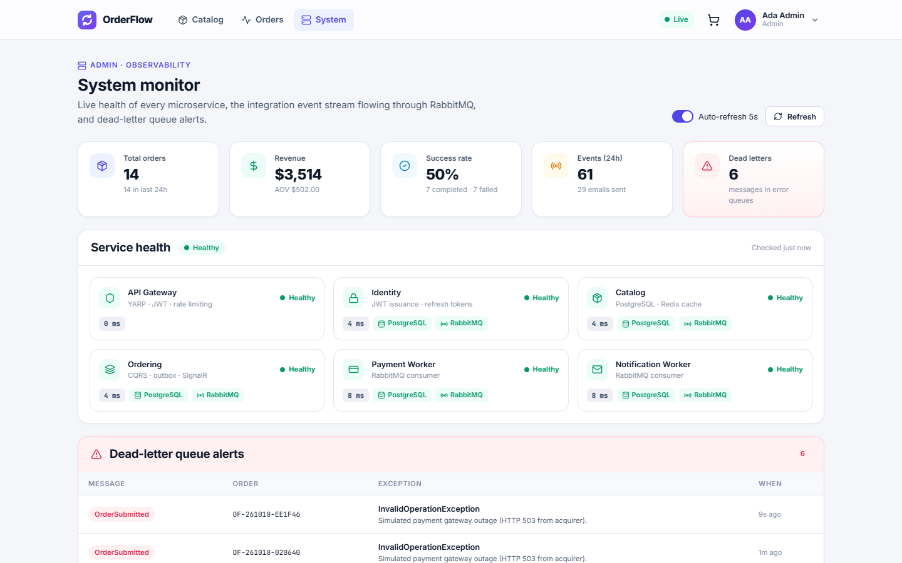
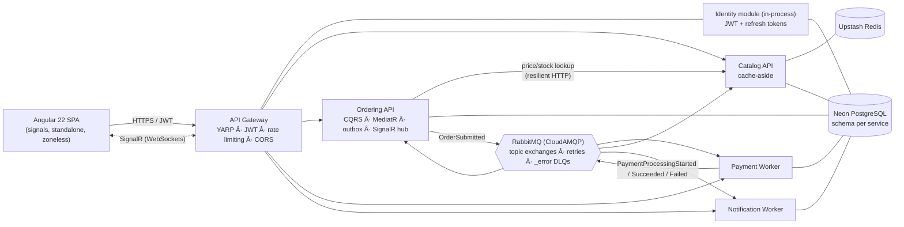
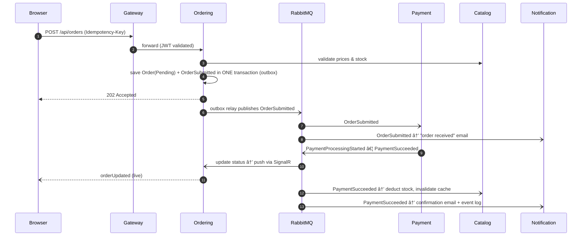
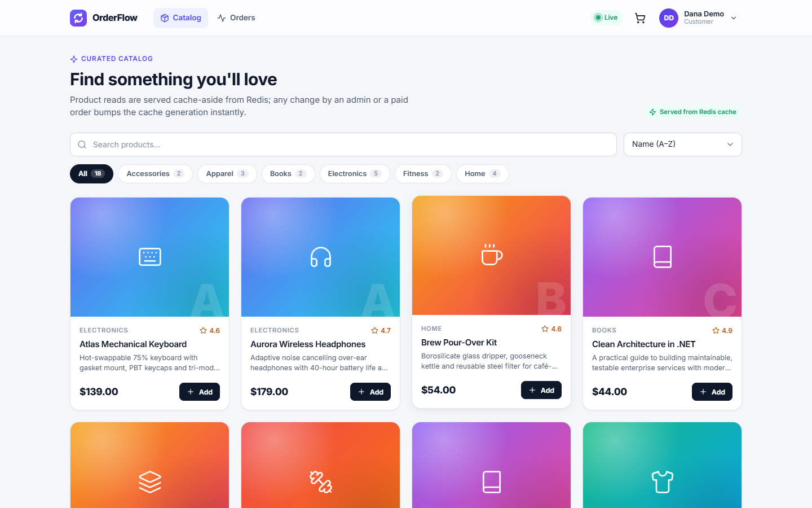
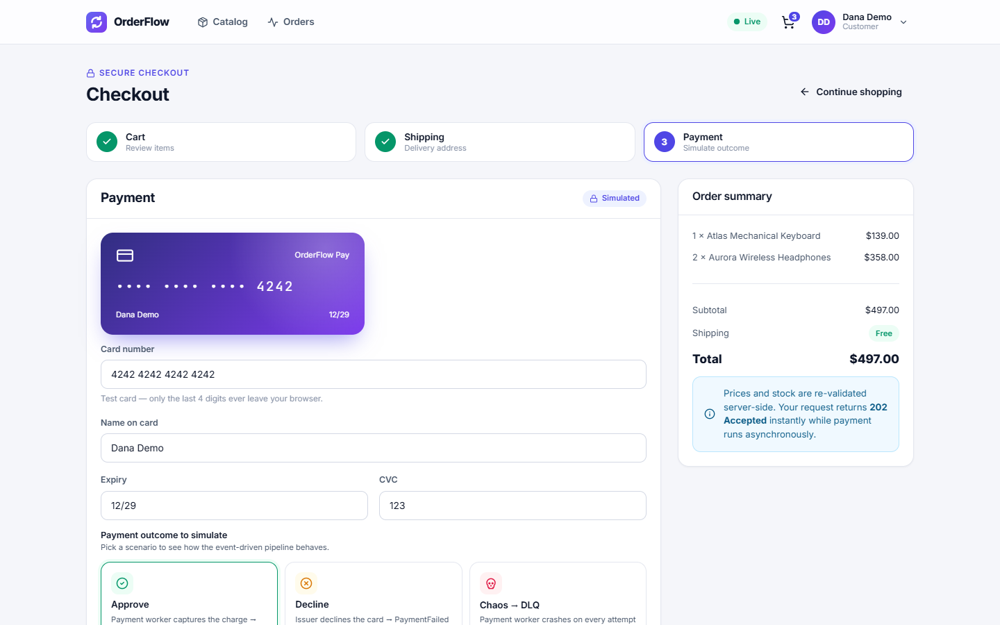
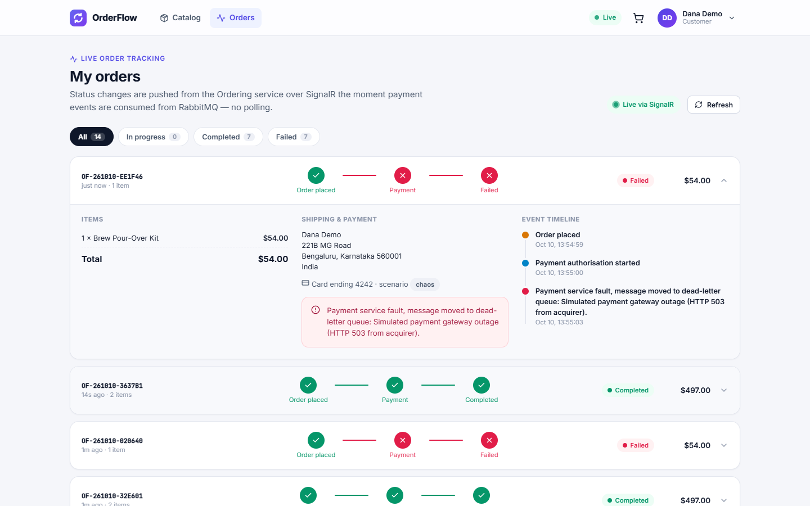
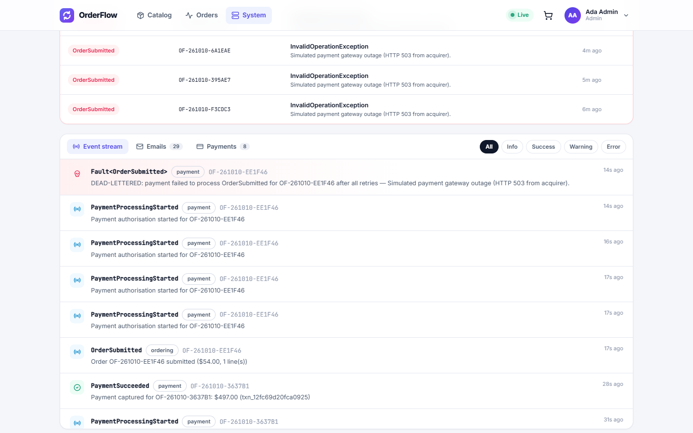

# OrderFlow — Event-Driven Microservices Commerce Platform

An e-commerce order platform built as **independent .NET 10 microservices** that talk to each other asynchronously over **RabbitMQ**, with an **Angular 22** frontend that shows every order moving through the pipeline **in real time over SignalR**.

It's built to show the patterns that keep distributed systems reliable: CQRS, the transactional outbox, idempotent consumers, retries, dead-letter queues with compensation, distributed caching, JWT auth with refresh-token rotation, rate limiting and health monitoring. It's also deployable entirely on **free tiers with no credit card**.



## Why

Monolithic checkouts couple everything together: one slow or failing dependency (payment, email) blocks the user's request or takes the whole system down. OrderFlow splits the work:

- **Loose coupling.** Services own their data and react to events instead of calling each other synchronously.
- **No lost messages.** Events are written atomically with business data (transactional outbox) and retried. Poison messages land in a dead-letter queue, and a compensating action runs instead of a silent failure.
- **Fast reads.** CQRS separates read and write paths, and the catalog is served cache-aside from Redis.
- **Responsive UX.** Checkout returns `202 Accepted` immediately, and status updates are pushed to the browser.

## Architecture



### Order lifecycle



If the payment worker crashes on every attempt (try the **Chaos → DLQ** option at checkout), MassTransit retries three times, moves the message to the `_error` dead-letter queue and publishes `Fault<OrderSubmitted>`. Ordering consumes the fault and fails the order with a clear reason (compensation). Notification records a dead-letter alert, which appears on the admin dashboard.

## Features

| Area | What's implemented |
| --- | --- |
| **Gateway** | YARP reverse proxy, JWT validation per route, role-based policies, per-IP fixed-window rate limiting (stricter on `/api/auth`), CORS, WebSocket proxying, aggregated health endpoint, warm-up endpoint for sleeping free-tier services |
| **Identity** | Registration and login, PBKDF2 password hashing, short-lived JWT access tokens, **rotating refresh tokens with reuse detection** (a reused token revokes every session), seeded demo accounts. Hosted in-process by the gateway (own schema and migrations) so sign-in needs one cold start on free hosting, not two |
| **Catalog** | Search, filter, sort and paging; **Redis cache-aside** with generation-based invalidation (`X-Cache: HIT/MISS` header); admin CRUD; idempotent stock deduction on `PaymentSucceeded`; `ProductStockLow` events |
| **Ordering** | **CQRS** with MediatR (commands and queries, validation and logging pipeline behaviors); DDD aggregate with a guarded state machine; **EF Core transactional outbox**; idempotency keys; optimistic concurrency (`xmin`); typed `HttpClient` with retry, circuit-breaker and timeout policies; **SignalR hub** with per-user and admin groups |
| **Payment worker** | Simulated gateway with approve, decline and chaos scenarios; idempotent via a unique index (never charges twice) |
| **Notification worker** | One queue bound to every event type; audit event log (JSONB), simulated customer emails, dead-letter alerts |
| **Cross-cutting** | RFC 9457 problem details, FluentValidation, health checks (Postgres, Redis, RabbitMQ), OpenAPI and Scalar docs at `/docs`, UUIDv7 keys, a schema per service, migrations on startup with retry for serverless databases |
| **Frontend** | Angular 22 standalone components and **signals** (zoneless), lazy routes, functional guards, JWT and refresh interceptors, global error interceptor, signal stores, reactive forms, live SignalR client with polling fallback, responsive custom design system |

## Pages

| Catalog (`/products`) | Checkout wizard (`/checkout`) |
| --- | --- |
|  |  |
| **Live order tracking (`/orders`)** | **Event stream (`/admin/logs`)** |
|  |  |

Demo accounts (one click on the login page):

| Role | Email | Password |
| --- | --- | --- |
| Customer | `demo@orderflow.dev` | `Demo@12345` |
| Admin | `admin@orderflow.dev` | `Admin@12345` |

## Tech stack

**Backend:** .NET 10, ASP.NET Core minimal APIs, YARP, EF Core 10 + Npgsql, MassTransit 8 (RabbitMQ), MediatR 12, FluentValidation, StackExchange.Redis, SignalR, Microsoft.Extensions.Http.Resilience, xUnit + Shouldly
**Frontend:** Angular 22, TypeScript, RxJS, `@microsoft/signalr`, SCSS
**Product photos:** [Unsplash](https://unsplash.com/license) (see `frontend/public/products/CREDITS.md`)
**Infrastructure (all free tiers, no credit card):** Render (Docker web services + static site CDN), Neon PostgreSQL, CloudAMQP RabbitMQ, Upstash Redis, GitHub Actions CI

## Repository layout

```
src/
  BuildingBlocks/
    OrderFlow.Contracts/         integration events shared by all services
    OrderFlow.ServiceDefaults/   auth, health, messaging, DB, problem details (one line per service)
  Gateway/OrderFlow.Gateway/     YARP gateway (hosts the Identity module)
  Services/
    Identity/  Catalog/  Ordering/  Payment/  Notification/
tests/OrderFlow.Ordering.Tests/  domain and validation unit tests
frontend/                        Angular app
scripts/
  run-local.ps1                  run every service locally (Postgres is the only dependency)
  smoke-test.mjs                 31-check end-to-end test through the gateway
render.yaml                      one-click Render Blueprint
docker-compose.yml               full stack with Postgres, RabbitMQ and Redis
```

## Run locally

**Option A, Docker:**

```bash
docker compose up --build
cd frontend && npm install && npm start      # http://localhost:4200
```

**Option B, no Docker.** You only need .NET 10, Node 22.22+ and a local PostgreSQL (`postgres`/`postgres` on port 5432 with a database named `orderflow`). Without `RABBITMQ_URL`, services use MassTransit's PostgreSQL transport, so the full event flow (retries, faults, DLQ) still works:

```powershell
./scripts/run-local.ps1                       # starts 6 services, logs in ./.logs
cd frontend; npm install; npm start           # http://localhost:4200
node scripts/smoke-test.mjs                   # 31 end-to-end checks
./scripts/run-local.ps1 -Stop
```

API docs: `http://localhost:510x/docs` (Scalar) on each service.

## Deploy for free

See **[docs/DEPLOYMENT.md](docs/DEPLOYMENT.md)**. You create four free accounts (none needs a credit card), create one environment group and apply the Blueprint.

> **Free-tier note:** Render spins services down after 15 minutes without traffic. The frontend calls the gateway's `/api/system/warmup` on load and shows a "waking up services" banner, so the first visit after a quiet period takes about a minute.
